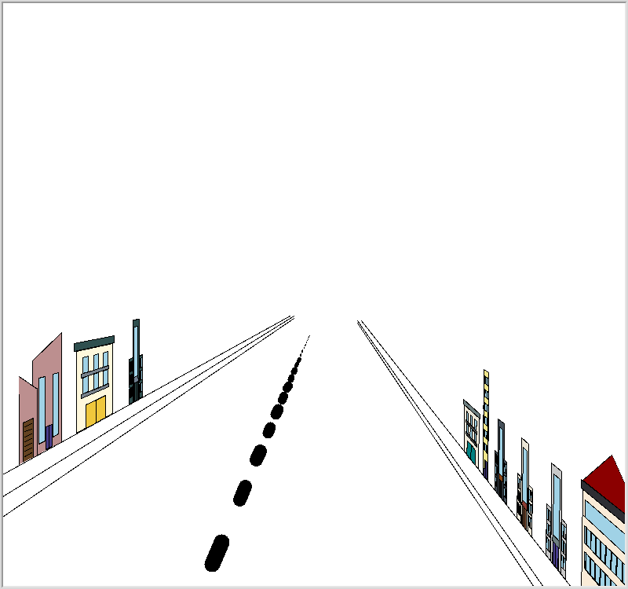

# Ciudad solarpunk en turtle

Generador de una ciudad en perspectiva hecho con `turtle` de Python. El programa dibuja una calle que se pierde en el horizonte y va levantando edificios a ambos lados, con ocho modelos distintos y colores elegidos al azar de una paleta. Cada generación redibuja la calle con edificios nuevos, cada vez más rápido.

La perspectiva se calcula a mano: el programa maneja coordenadas 3D, rotaciones y una distancia focal para proyectar cada punto a la pantalla.



## Cómo ejecutarlo

Requiere Python 3 con Tk (en Arch: `sudo pacman -S tk`; en Debian/Ubuntu: `sudo apt install python3-tk`).

```
python ciudad_solarpunk.py
```

En la terminal el programa pide:

- Alto, ancho y separación de los edificios (valores como 300, 200 y 80 funcionan bien)
- Cantidad de edificios por generación
- Velocidad: segundos entre generaciones (se recomienda menos de 5)
- Cantidad de generaciones (máximo 900)

Al terminar, se cierra con un clic en la ventana.

## Contexto

Proyecto individual de un curso del TEC (Instituto Tecnológico de Costa Rica).

Autor: Samuel Ureña

## Licencia

MIT
